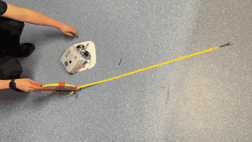

# Must be the Wind

A 1 kg autonomous sumo robot that sucks itself onto the ring with a ducted fan, so its tyres grip harder than its own weight alone could make them.

Four-person team build for a university embedded-systems course (2026).

This repo is the build record: the printable STL & STEP files with their print presets, the design notes from every chassis revision, the wiring at block level, the measured-parts data and the photos. The firmware is described in [docs/FIRMWARE_OVERVIEW.md](docs/FIRMWARE_OVERVIEW.md) but its source isn't published, at the course coordinator's request.

## My role

I led the four-person team & did the integration, from the first concept on 2 Sep 2026 to the competition on 15 Oct. I sourced the parts and took the chassis from v5 to v11, which for me was chassis design, briefing and printing: the geometry came from AI CAD agents working to briefs I wrote, and I held the design, checked what came back against parts I'd measured & decided what got printed. I printed every part on the robot, cast the silicone tyres and did the downforce fan. I also wrote the wiring guides, the competition firmware (v2.5, the build that fought, not published here) and most of the documentation, and I ran the repo.

**[Leadership lessons from running this build (docs/LEADERSHIP.md)](docs/LEADERSHIP.md).** What went wrong with the team's check-ins, what I'd change, and the rule I now use for handovers.

## The robot at a glance

As it competed on 15 Oct 2026:

- **Mass:** 1.000 kg at the 13 Oct weigh-in (before the skirt's final paint coat), right on the 1 kg limit.
- **Size:** 249 × 249 mm footprint, so it fits inside a 250 mm cube.
- **Brain:** LilyGO T-Display S3, a small ESP32-S3 board (a dual-core microcontroller with Wi-Fi built in) with its own colour screen.
- **Drive:** 2 JGA25-371 gearmotors (25 mm geared DC motors, 12 V, 130 rpm), each on a DRV8871 (a single-chip motor driver), steering by skid like a tank.
- **Opponent sensing:** 7 VL53L0X time-of-flight distance sensors (tiny laser rangefinders) looking out around the body. 5 of the 7 were live on competition day.
- **Edge sensing:** 4 TCRT5000 sensors (infrared reflectance sensors that can tell the ring surface from its rim) in the corners. Only 1 of the 4 was trusted on competition day.
- **Downforce:** a 40 mm EDF (electric ducted fan) driven by an ESC (the electronic speed controller for its brushless motor), pulling air out of a sealed base.
- **Wheels:** cast silicone tyres (Mold Star 15, a soft pourable silicone rubber) on 3D-printed hubs.
- **Power:** a 3S 2200 mAh LiPo (three-cell lithium polymer pack, 11.1 V nominal) behind an XT60 (a high-current plug) loop key that doubles as the main switch.
- **Start & stop:** GO and STOP sent from a second board at the laptop over ESP-NOW (Espressif's direct board-to-board radio link).
- **Printed parts:** PLA (a stiff, easy-printing plastic) base, translucent PETG (a tougher, slightly flexible plastic) lid, ABS (a heat-resistant plastic) wheel hubs.

## Result

1 win, 2 losses, and one bout forfeited after a mid-bout restart, at the competition on 15 Oct 2026 ([closing note](docs/status/2026-10-16_project_final.md)).

**On AI tools:** the chassis geometry was built by AI CAD agents working to briefs I wrote, and I held the design, checked every result against measured parts, printed it and made the calls.

## Where things are

- [Firmware overview](docs/FIRMWARE_OVERVIEW.md): how a match runs, the priority ladder, the safety interlocks and what I learnt.
- [Leadership lessons](docs/LEADERSHIP.md): running the team, and what I do differently now.
- [Decision log](docs/DECISIONS.md): why each big call went the way it did, newest first.
- [Chassis](docs/chassis/README.md): every revision from v5 to v11, with the [v11 start page](docs/chassis/v11/START_HERE.md) and its [changelog](docs/chassis/v11/CHANGELOG.md).
- [CAD files](hardware/cad/README.md): STL, STEP, Bambu Studio presets and the layout model, with [print settings](docs/printing/BAMBU_PRESET_RECIPE.md) for each part.
- [Downforce fan](docs/DOWNFORCE_FAN.md), [wheel & tyre trade study](docs/WHEEL_TYRE.md), [tyre casting](docs/WHEEL_V1.md) and the [wheel hub lineage](docs/wheels/README.md).
- [Wiring overview](docs/hardware/WIRING_OVERVIEW.md) and the [pin map](docs/PIN_MAP.md), both at block level.
- [Hardware spec sheet](docs/hardware/HARDWARE_SPEC_SHEET.md), [measured parts](docs/hardware/MEASURED_PARTS.md), [mass budget](docs/hardware/MASS_BUDGET.md), [bill of materials](docs/BOM.md) and the [risk register](docs/RISK_REGISTER.md).
- Status notes: [first drive, 23 Sep](docs/status/2026-09-23_first_drive.md) and the [closing note, 16 Oct](docs/status/2026-10-16_project_final.md). Design approvals are in [docs/admin/DESIGN_APPROVALS.md](docs/admin/DESIGN_APPROVALS.md).

## Gallery

**8 Sep 2026.** An early translucent round chassis shell with ribbed side skirts, long before the final square shape.

**21 Sep 2026.** The base plate with the two 12 V 130 rpm gearmotors, the earlier foam wheels and the ducted fan, before any electronics went in.

**23 Sep 2026.** Bench electronics: the T-Display controller, a buck converter on perfboard, the two motor drivers and the XT60 input.

**23 Sep 2026.** The drive motors in their printed clamps under the electronics deck, with the ducted fan in front.

**23 Sep 2026.** The first drive, 1 m out and back on a timed run ([write-up](docs/status/2026-09-23_first_drive.md)).

**11 Oct 2026.** Assembled with the clear PETG lid, distance sensors sitting in the side windows.

**11 Oct 2026.** The underside: wheels in their sealed wells, the fan intake in the middle and the corner edge-sensor windows.

**13 Oct 2026.** Lid open, showing a distance sensor in its printed pocket and the fan duct ring with its foam lining.

**13 Oct 2026.** The competition build from the top, with the fan grille, display window and sensor windows.

**14 Oct 2026.** The status screen during bench testing: live distance readings, how many sensors are up, and the GO/STOP link.

## Team

Four people: lead & integration (me), hardware build, and two of us on sensor firmware & bench tuning.

---

© 2026 the project team. Shared for viewing, not licensed for reuse.
