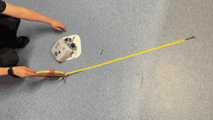

# SumoBot, first drive, 23 Sep 2026

> **Superseded at project close (16 Oct 2026).** A 23 Sep snapshot. Final state: [`2026-10-16_project_final.md`](2026-10-16_project_final.md).

The first milestone was one thing, the bot drives 1 m forward, stops, & drives 1 m back under its own power. As of 23 Sep it does. It runs on the real v11 chassis with the real motors & battery, on a simple timed drive. This page covers what got built to get there, what went wrong on the way, what the run actually looks like, & what's left to tune.

## What's on the bench

This is the drive-only build, so only the parts this test needs are wired. That's the 3S 2200 mAh pack through the key socket, an MP1584 buck feeding the T-Display S3's 5V pin directly (the diode from the first guide was dropped, which is why USB never goes in with the key in), a 1000 µF bulk cap at the XT60 input, two DRV8871 drivers with a 220 µF cap on each driver's supply, and the two JGA25-371 motors (12 V, 130 rpm) with their encoders wired to GPIO 21 & 44. The Brain sits on a breadboard on top of the bot for now & moves to its protoboard next. The ToFs, line sensors & fan are all left off until the next build stage, though the ESC's power leads are already on the main power junction so that joint never has to be reopened.

Pins, same as the full build:

| T-Display S3 pin | Goes to |
|---|---|
| 11 / 12 | Driver L IN1 / IN2 |
| 13 / 16 | Driver R IN1 / IN2 |
| 21 / 44 | Motor L / R encoder channel A (10 k pull-up to 3V3) |
| 14 or 0 | onboard buttons, either one starts the run |

## First power-up (22 Sep)

The first key-in on 22 Sep got the board & screen alive and the left motor spinning, but the right motor didn't move and both encoder counts sat at 0. The two most likely causes from the wiring review were the encoder signal wires from the pull-up nodes to the TTGO never being landed, and the right motor's winding and encoder ground being swapped (one motor metered white as M− & black as encoder ground, and the second wasn't metered separately before it was wired, so meter each motor's leads before wiring it). On 23 Sep the harness joints were reworked & resoldered, both motors came up, and both encoders now count. The exact joint that was at fault wasn't isolated before the rework, so it isn't recorded here, and if it comes back metering each motor's leads is the place to start.

## Why the timed drive

An encoder-counted 1 m drive with a straight-line correction was written alongside it, but the timed build is the one that ran, because it's the simplest thing that does the job and it doesn't depend on the encoders at all. It does exactly one thing when a button is pressed, full power forward for a fixed time, brake (both driver inputs high), a short pause, full power back for the same time, brake. The run time comes from the motor spec, 130 rpm on a 46.8 mm wheel is about 0.32 m/s unloaded, so a metre is about 3.1 s, rounded up a little to allow for load, and on the floor it lands close to the metre.

It's open loop. The distance depends on battery voltage & floor grip and nothing corrects the heading, which is the price of keeping the code this simple.

## What the run looks like

Full clip: [`media/first-drive/first_drive_2026-09-23.mp4`](../../media/first-drive/first_drive_2026-09-23.mp4).

| Leg | Result |
|---|---|
| Forward 1 m | reaches the metre, drifting gradually right, about 100 mm off the line by the end |
| Back 1 m | returns close to the start, finishing about 50 mm right of where it began |

The drift builds up across the leg rather than happening as a jolt at the start, which points to a steady difference between the two sides rather than a launch problem. 100 mm of sideways error over 1 m is roughly a 5 m radius arc, so the bot is about 11° off heading by the end of the forward leg. Reversing the same mismatch mostly unwinds that arc, which is why the return nearly closes, and the 50 mm it doesn't close by suggests the mismatch isn't the same forward as backward.

The motors are staggered ±14 mm fore & aft by design (so the two carriers fit around the fan), which was the first suspect. On its own it shouldn't steer the bot, as long as both axles are parallel and both wheels turn at the same speed. The likelier causes, in the order they'll be checked:

1. **Motor-to-motor speed difference.** Two cheap gearmotors at the same power setting won't turn at the same speed, and a gap of a few percent is enough for this drift (the exact figure depends on the track width, which hasn't been measured on the built chassis yet).
2. **A carrier sitting with slight toe**, so one axle isn't square to the direction of travel.
3. **Uneven grip**, a wheel that's slipping more or a tyre that isn't sitting evenly on its hub.

## Next

- Measure the track width & run the timed drive against tape a few times to get a repeatable drift figure.
- Trim it out in the timed build first, by dropping the faster side below full power until the forward leg runs straight, then check the return leg.
- Move to the encoder-counted drive, now that both encoders count, which stops on distance rather than time and corrects heading from the difference between the two tick counts, so it isn't sensitive to battery voltage or motor mismatch.
- Check both carriers for toe while the lid is off.

The timed build proved the drivetrain, & the encoder build is the one planned to carry into the competition code.

## Mass

The bot weighed **765 g** on 23 Sep with the breadboard aboard, before any ToF or line sensors went in, and the weigh-in photo shows the lid on ([photo](../../media/first-drive/mass_765g_2026-09-23.jpg)). The limit is 1 kg, and the full budget is in `docs/hardware/MASS_BUDGET.md`.
